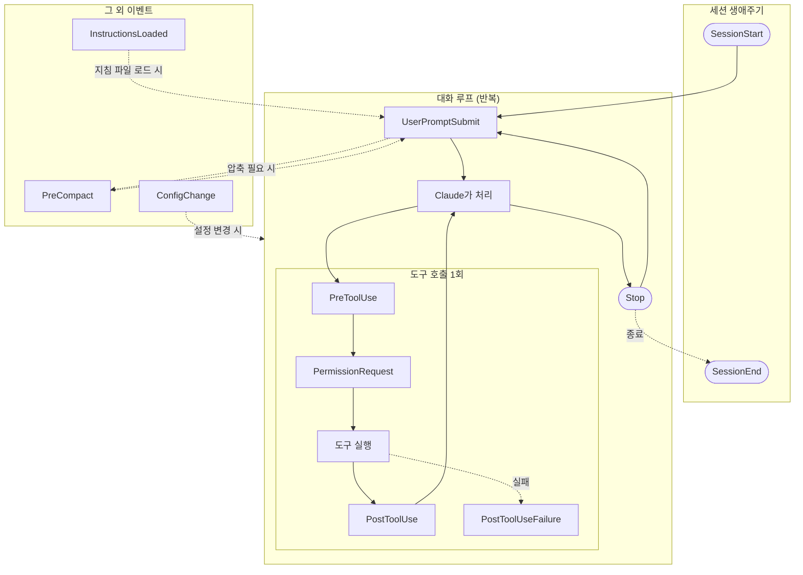

# claude-code-agile-hooks

[](https://github.com/coralstay/claude-code-agile-hooks/actions/workflows/ci.yml)

> 이전 이름은 `claude-rails`입니다. 이름 그대로, Claude Code 작업에 애자일(스크럼·칸반) 절차와
> 품질·안전 게이트를 거는 훅 모음입니다. 옛 설정 파일 `.claude-rails.json`도 계속 읽습니다.

에이전트(Claude Code)를 사용하기 위해 개인적으로 만들어 사용하고 있는 훅 모음집입니다.
Claude Code와 함께 작업할 때, Claude가 제가 의도한 대로 행동할 수 있도록 돕기 위해
만들었습니다.

## 왜 필요했는지 말씀드립니다

CLAUDE.md에 "이렇게 해주세요"라고 적어두는 약속만으로는 매번 지켜지기가 쉽지
않습니다. 프롬프트 인젝션이나 컨텍스트 압축처럼, 의도와 다르게 흘러갈 수 있는
지점들이 있기 때문입니다. 그래서 기계적으로 검증할 수 있는 규칙은 훅(코드)으로
물리적으로 강제하도록 하였고, 결국 사람의 판단이 필요한 두 지점(백로그 승인, push
전 코드 리뷰)만은 정직하게 사람에게 맡겨두었습니다. 정해진 규칙을 벗어나는 순간
해당 액션 자체가 실행되지 않도록 만든 것이 이 저장소의 핵심이라고 말씀드릴 수
있습니다.

## 무엇을 만들었는지 말씀드립니다

Claude Code의 [hooks](https://code.claude.com/docs/ko/hooks) 이벤트마다 동작하는
34개의 스크립트를 만들었습니다.
[Backlog.md](https://github.com/MrLesk/Backlog.md)(Git 저장소 안에 마크다운 파일로
태스크·문서·의사결정을 관리하는 CLI 기반 프로젝트 관리 도구입니다) 워크플로 전용
9개와, 프로젝트 종류와 무관하게 항상 켜져 있는 범용 안전/관측 훅 25개로 이루어져
있습니다. 모든 훅은 개인 fork 안에서만 강하게 적용되며, 운영 레포로 올리는 PR은
항상 사람이 직접 열도록 하였습니다.

## 주요 특징을 소개해 드립니다

- **기계적 강제와 사람의 판단을 명확히 나누었습니다** — 검증 가능한 부분은 훅으로
  막고, 백로그 승인과 push 전 코드 리뷰 두 곳만 사람에게 맡겨두었습니다.
- **완전히 독립적으로 만들었습니다** — 훅끼리 서로 import하지 않아, 코드 중복은
  있지만 한 훅의 버그가 다른 훅에 영향을 주지 않도록 하였습니다.
- **Python으로 작성하였습니다** — 원래 여러 개는 bash 스크립트였으나, 셸보다
  가독성이 낫고 작성자가 Python 생태계에 더 익숙하다는 실용적인 이유로 Python으로
  옮겼습니다. 여러 대안을 검토하기는 하였으나, 정답이 하나만 있는 문제는 아니었다고
  생각합니다.

## 훅을 생애주기별로 정리해 드립니다

Claude Code의 훅은 [공식 문서](https://code.claude.com/docs/ko/hooks)에 정의된
특정 이벤트(생애주기 단계)에 등록되어, 그 시점에만 실행됩니다. 전체 흐름을 먼저
그림으로 보여드린 뒤, 이 저장소에 있는 34개의 훅이 각각 어느 단계에서 동작하는지
표로 정리해 드리겠습니다.



이 저장소의 훅은 이 흐름 중 필요한 지점마다 걸려 있습니다 — 예를 들어
`require_active_task.py`는 `PreToolUse`(Edit\|Write)에, `block_stop_if_dirty.py`는
`Stop`에 걸려서 각각 해당 시점의 행동을 검증합니다. 아래 표는 34개 훅 전체가 정확히
어느 단계에 걸려 있는지 나열한 것입니다. 훅 이름을 누르시면 실제 소스 파일로
이동합니다.

| 생애주기                            | 훅                                                                 | 범위       | 하는 일                           |
| ----------------------------------- | ------------------------------------------------------------------ | ---------- | --------------------------------- |
| SessionStart                        | [`session_start.py`](hooks/session_start.py)                       | 🔒 backlog | 워크플로 가이드/무결성 이슈 주입  |
| SessionStart                        | [`session_logger.py`](hooks/session_logger.py)                     | 범용       | 세션 시작 로그                    |
| SessionStart                        | [`dead_rules_audit.py`](hooks/dead_rules_audit.py)                 | 범용       | 규칙 준수 스코어카드 시작         |
| SessionStart                        | [`standup_autopilot.py`](hooks/standup_autopilot.py)               | 범용       | 전날 미해결 항목 재주입           |
| SessionStart                        | [`bounty_board.py`](hooks/bounty_board.py)                         | 범용       | TODO/FIXME 부채 현황 표시         |
| SessionStart                        | [`context_flags.py`](hooks/context_flags.py)                       | 범용       | post_compact 플래그 기록          |
| SessionStart                        | [`recap_archive.py`](hooks/recap_archive.py)                       | 범용       | recap(away_summary) 아카이브 적재 |
| UserPromptSubmit                    | [`instructions_audit.py`](hooks/instructions_audit.py)             | 범용       | 적대적 지시 탐지 시 프롬프트 차단 |
| UserPromptSubmit                    | [`session_logger.py`](hooks/session_logger.py)                     | 범용       | 프롬프트 로그                     |
| UserPromptSubmit                    | [`dead_end_registry.py`](hooks/dead_end_registry.py)               | 범용       | 되돌림 패턴 감지                  |
| UserPromptSubmit                    | [`pipeline_trace.py`](hooks/pipeline_trace.py)                     | 범용       | plan mode 진입 기록               |
| PreToolUse: Edit\|Write             | [`require_active_task.py`](hooks/require_active_task.py)           | 🔒 backlog | In Progress 태스크 없으면 차단 (프로젝트 밖 경로는 제외) |
| PreToolUse: Edit\|Write             | [`dead_end_registry.py`](hooks/dead_end_registry.py)               | 범용       | 죽은 접근 재시도 경고             |
| PreToolUse: Edit\|Write             | [`require_test_first.py`](hooks/require_test_first.py)             | 🔒 backlog | (opt-in `testFirst`) 다음 AC의 `<ID>#<n>`·관련 규칙 `<ID>#B<k>` 테스트 표식 없으면 소스 편집 차단 |
| PreToolUse: Bash                    | [`pre_commit_check.py`](hooks/pre_commit_check.py)                 | 🔒 backlog | 브랜치/테스트 확인 후 커밋 허용   |
| PreToolUse: Bash                    | [`backlog_commit_scope.py`](hooks/backlog_commit_scope.py)         | 🔒 backlog | 드래프트 생성/승격·상태 전환 커밋에 다른 변경 섞이거나 새 드래프트가 2장 이상이면 차단 |
| PreToolUse: Bash(git *)             | [`dedup_drift_guard.py`](hooks/dedup_drift_guard.py)               | 범용       | 복붙 함수 drift 시 커밋 차단      |
| PreToolUse: Bash                    | [`pre_push_check.py`](hooks/pre_push_check.py)                     | 🔒 backlog | Done+summary 확인 후 push 허용    |
| PreToolUse: Bash                    | [`pre_push_coverage_check.py`](hooks/pre_push_coverage_check.py)   | 범용       | 커버리지 확인                     |
| PreToolUse: Bash                    | [`pre_git_safety_check.py`](hooks/pre_git_safety_check.py)         | 범용       | main 직접 push/파괴적 gh 차단     |
| PreToolUse: Bash                    | [`require_draft_first.py`](hooks/require_draft_first.py)           | 🔒 backlog | `backlog task create` 차단, 드래프트 경유 안내 |
| PreToolUse: Bash                    | [`require_implementation_plan.py`](hooks/require_implementation_plan.py) | 🔒 backlog | SOAP 구현 계획·AC·DoD 없으면 `draft promote` 차단, 거기에 사람 서명자(`humanSigners`)가 서명한 `Plan-Approved: <ID>` 커밋(계획 승인)까지 없으면 `-s "In Progress"` 차단 |
| PreToolUse: Bash                    | [`require_stage_committed.py`](hooks/require_stage_committed.py)   | 🔒 backlog | 커밋 안 된 `backlog/` 변경이 있으면 다음 단계 명령(draft create·promote·`-s "In Progress"`·`-s Done`) 차단 |
| PreToolUse: Bash                    | [`require_test_first.py`](hooks/require_test_first.py)             | 🔒 backlog | (opt-in `testFirst`) 모든 AC·규칙 표식 없으면 `backlog task edit <ID> -s Done` 차단 |
| PreToolUse: Bash                    | [`block_dangerous_commands.py`](hooks/block_dangerous_commands.py) | 범용       | 위험 명령 차단                    |
| PreToolUse: Bash                    | [`case_insensitive_guard.py`](hooks/case_insensitive_guard.py)     | 범용       | 대소문자 경로 삭제 오발사 방지    |
| PreToolUse: Bash(gh pr create*)     | [`pr_provenance_stamp.py`](hooks/pr_provenance_stamp.py)           | 범용       | PR 본문에 provenance 삽입         |
| PreToolUse: Read\|Edit\|Write\|Bash | [`protect_secrets.py`](hooks/protect_secrets.py)                   | 범용       | 시크릿 파일 보호                  |
| PreToolUse: Bash\|Edit\|Write       | [`protect_tests.py`](hooks/protect_tests.py)                       | 범용       | 가짜 그린 방지                    |
| PreToolUse: Bash\|Edit\|Write       | [`config_guard.py`](hooks/config_guard.py)                         | 범용       | 자기 설정 변조 차단               |
| PreToolUse: 전체                    | [`instructions_audit.py`](hooks/instructions_audit.py)             | 범용       | 락 파일 있으면 전체 차단          |
| PostToolUse: 전체                   | [`session_logger.py`](hooks/session_logger.py)                     | 범용       | 도구 결과 로그                    |
| PostToolUse: 전체                   | [`nerf_receipts.py`](hooks/nerf_receipts.py)                       | 범용       | 실패율/토큰 사용량 기록           |
| PostToolUse: 전체                   | [`pipeline_trace.py`](hooks/pipeline_trace.py)                     | 범용       | 계획 승인·드래프트·커밋·수정 기록 |
| PostToolUse: Edit\|Write            | [`auto_stage.py`](hooks/auto_stage.py)                             | 범용       | 자동 git add                      |
| PostToolUse: Edit\|Write            | [`dead_rules_audit.py`](hooks/dead_rules_audit.py)                 | 범용       | 규칙 준수 집계 갱신               |
| PostToolUse: Edit\|Write            | [`bounty_board.py`](hooks/bounty_board.py)                         | 범용       | TODO/FIXME XP 지급                |
| PostToolUse: Read\|Grep\|Glob\|Bash | [`context_hogs.py`](hooks/context_hogs.py)                         | 범용       | 컨텍스트 소비 리더보드            |
| PostToolUseFailure                  | [`nerf_receipts.py`](hooks/nerf_receipts.py)                       | 범용       | 실패 로그                         |
| Stop                                | [`block_stop_if_dirty.py`](hooks/block_stop_if_dirty.py)           | 🔒 backlog | dirty면 턴 종료 차단              |
| Stop                                | [`reserved_tag_guard.py`](hooks/reserved_tag_guard.py)             | 범용       | 예약 태그 출력 시 정정 요구       |
| Stop                                | [`nerf_receipts.py`](hooks/nerf_receipts.py)                       | 범용       | Stop 로그                         |
| Stop                                | [`standup_autopilot.py`](hooks/standup_autopilot.py)               | 범용       | 스탠드업 파일 갱신                |
| Stop                                | [`context_flags.py`](hooks/context_flags.py)                       | 범용       | parallel_session 플래그 기록      |
| Stop                                | [`pipeline_trace.py`](hooks/pipeline_trace.py)                     | 범용       | 계획 없는 수정 경고(비차단)       |
| SessionEnd                          | [`session_logger.py`](hooks/session_logger.py)                     | 범용       | 세션 종료 로그                    |
| SessionEnd                          | [`dead_rules_audit.py`](hooks/dead_rules_audit.py)                 | 범용       | 규칙 준수 집계 마무리             |
| SessionEnd                          | [`standup_autopilot.py`](hooks/standup_autopilot.py)               | 범용       | 스탠드업 파일 마무리              |
| SessionEnd                          | [`recap_archive.py`](hooks/recap_archive.py)                       | 범용       | recap(away_summary) 아카이브 적재 |
| ConfigChange                        | [`config_watch.py`](hooks/config_watch.py)                         | 범용       | 아웃오브밴드 설정 변경 감지       |
| PreCompact                          | [`pre_compact_backup.py`](hooks/pre_compact_backup.py)             | 범용       | 압축 전 transcript 백업           |
| PreCompact                          | [`context_flags.py`](hooks/context_flags.py)                       | 범용       | 압축 trigger 플래그 기록          |
| PermissionRequest                   | [`permission_auto_allow.py`](hooks/permission_auto_allow.py)       | 범용       | 안전한 요청 자동 승인             |
| InstructionsLoaded                  | [`instructions_audit.py`](hooks/instructions_audit.py)             | 범용       | 로드 시점 적대적 지시 스캔        |

같은 훅이 여러 이벤트에 등록된 경우(예: `session_logger.py`, `nerf_receipts.py`,
`instructions_audit.py`)에는 행마다 반복하여 표기해 드렸습니다. 실제
`settings.hooks.json`에 등록된 내용과 1:1로 대응시켜 드리기 위함입니다.

## 설치 방법을 안내해 드립니다

```bash
cd ~/githubs/claude-code-agile-hooks && ./install.sh
```

`~/.claude/settings.json`에는 [`scripts/merge_settings.py`](scripts/merge_settings.py)로
**추가 전용 병합**을 합니다. 다른 도구의 훅은 그대로 두고, 빠진 claude-code-agile-hooks 항목만
(이벤트, matcher) 그룹에 추가하므로 다시 실행해도 중복되지 않습니다. 쓰기 전에
`settings.json.bak.<timestamp>`로 백업하고, 추가/갱신된 항목을 목록으로 보여 드립니다.

옛 이름(`claude-rails`)으로 설치하셨다면 `~/.claude/hooks/claude-rails/`를 가리키던 훅 항목은 같은
자리에서 새 경로(`~/.claude/hooks/claude-code-agile-hooks/`)로 바뀌므로 훅이 두 번 돌지 않습니다. 옛 설치
디렉토리와 `~/.claude/CLAUDE.md`의 옛 `CLAUDE-RAILS` 마커 블록은 설치 스크립트가 안내만 하고
건드리지 않으니, 새 설치본이 동작하는 것을 확인하신 뒤 직접 지워 주세요.

테스트와 커버리지는 저장소 루트에서 확인합니다. 설정은 [`pyproject.toml`](pyproject.toml)에
있고, `hooks/`·`scripts/` 전체의 줄·분기 커버리지가 100% 미만이면 실패합니다.

```bash
uvx --with pytest-cov pytest -q --cov                                  # 순차 실행
uvx --with pytest-cov --with pytest-xdist pytest -q -n auto --cov      # 병렬 실행 (더 빠름)
```

테스트에는 단위 테스트 외에 계약 테스트 두 개가 있습니다.
[`hooks/test_hook_registration_contract.py`](hooks/test_hook_registration_contract.py)는
`if` 필터가 훅이 검사할 명령을 가리지 않는지 확인하고,
[`hooks/test_hook_runtime_contract.py`](hooks/test_hook_runtime_contract.py)는
`settings.hooks.json`에 등록된 모든 훅을 Claude Code처럼 실제 subprocess로 실행해 빈
입력·깨진 JSON·정상 입력에서 크래시 없이 정해진 종료 코드를 내는지 확인합니다. 이때 `HOME`을
임시 디렉토리로 바꿔 실행하므로 실제 `~/.claude`는 건드리지 않습니다.

**CI**: [`.github/workflows/ci.yml`](.github/workflows/ci.yml)이 `main` push와 모든 PR에서
ubuntu·macOS × Python 3.11·3.12로 위의 병렬 명령을 돌립니다. 커버리지가 100% 미만이면
실패합니다.

**로컬 게이트**: 이 저장소에도 [`.claude-code-agile-hooks.json`](.claude-code-agile-hooks.json)이 있어서, 설치된
훅이 이 저장소에서 커밋할 때마다 `testCommand`(병렬 테스트, 커버리지 없이)를, push할
때마다 `coverageCommand`(CI와 같은 명령)를 돌립니다. 실패하면 커밋·push가 막힙니다. push
때의 실행 기록은 `.claude-code-agile-hooks/coverage-log.jsonl`에 남고, 이 디렉토리는 git에서
제외됩니다. 아직 옛 이름 `.claude-rails.json`만 쓰는 프로젝트에서는 그 설정을 그대로 읽고
기록도 예전처럼 `.claude-rails/`에 남깁니다.

**테스트 먼저(opt-in)**: 프로젝트 설정에
`"testFirst": {"sourceGlobs": ["src/main/java/**"], "testGlobs": ["src/test/java/**"]}`를 넣으면
`require_test_first.py`가 AC 하나씩 TDD를 강제합니다. `task/<ID>` 브랜치에서 그 태스크가 In
Progress일 때, 소스 파일을 고치기 전에 체크 안 된 첫 AC n의 표식 `<ID>#<n>`과 그 AC에 묶인
비즈니스 규칙 표식 `<ID>#B<k>`가 테스트 파일 어딘가에 있어야 하고, `backlog task edit <ID> -s
Done` 전에는 모든 AC·규칙 표식이 있어야 합니다. 비즈니스 규칙은 카드 설명의 `## 비즈니스 규칙`
절에 `- B<k> (AC #<n>) <규칙>` 형식으로 적습니다. 표식 문자열만 보므로 테스트가 실제로 먼저
실패했는지는 확인하지 않고, Bash로 쓴 소스 파일도 보지 못합니다.

**구현 계획과 계획 승인(계획 → 리뷰 → 계획 승인)**: `require_implementation_plan.py`는 `backlog draft promote <ID>`와
`backlog task edit <ID> -s "In Progress"`를 카드 파일을 읽어 검사합니다. 카드에는 AC와 DoD가
하나 이상 있어야 하고, Implementation Plan(`--plan`)은 아래 SOAP 예약 제목 네 개를 이 순서로 한
번씩, 철자 그대로 쓰고 각 절에 본문을 채워야 합니다(대소문자·띄어쓰기·제목 수준 변형은 인정하지
않습니다). 제목이 없거나, 순서가 다르거나, 두 번 나오거나, 본문이 비어 있으면 무엇이 빠졌는지
안내하며 막습니다.

```markdown
### Subjective
요청 · 배경: 유저가 무엇을 왜 원하는가

### Objective
확인한 사실: 코드 · 측정값 · 현재 동작

### Assessment
판단: 문제가 무엇이고 어떤 접근을 고르는가

### Plan
구현 순서
```

In Progress로 옮길 때는 여기에 더해 승인 게이트를 통과해야 합니다 — 계획 → 리뷰 → 계획 승인.
계획 승인은 사람이 계획을 리뷰한 뒤 자기 키로 직접 서명해 남기는 빈 커밋입니다.

```bash
git commit --allow-empty -S -m "Plan-Approved: <ID>"   # 예: git commit --allow-empty -S -m "Plan-Approved: TASK-58"
```

훅은 HEAD에서 닿는 커밋 중 제목이 정확히 `Plan-Approved: <ID>`인 커밋을 찾고, 그중 하나라도
`git log --format=%G?`가 `G`(유효한 서명)이고 서명자 principal(`%GS`)이 프로젝트 설정의
`humanSigners`에 있어야 통과시킵니다. 승인 커밋이 없을 때, 서명이 유효하지 않을 때(`%G?` ≠ `G`),
사람이 아닌 서명자가 서명했을 때를 구분해 안내합니다. 훅은 계획 승인 커밋을 만들지 않고, Claude도
만들지 않습니다 — 유저에게 리뷰와 계획 승인을 요청합니다.

```json
{ "humanSigners": ["human"] }
```

사람과 Claude를 서명으로 구분하려면 키를 둘로 나눕니다(사람이 직접 설정합니다).

- **AI 키**: Claude Code 세션 전용 키를 따로 만들고, `~/.claude/settings.json`의 `env`로 그
  세션에서만 서명 키를 바꿉니다:
  `"GIT_CONFIG_COUNT": "1", "GIT_CONFIG_KEY_0": "user.signingkey", "GIT_CONFIG_VALUE_0": "<AI 키 .pub 파일의 절대 경로>"`.
- **사람 키**: 기존 키는 ssh-agent에서 내려(`ssh-add -d`) 서명할 때마다 암호를 입력해야 하게
  둡니다. 그래야 Claude 세션이 사람 키로 조용히 서명할 수 없습니다.
- **allowed_signers**: `~/.ssh/allowed_signers`에 두 키를 서로 다른 principal로 올리고
  (`human <사람 공개키>`, `ai-claude-code <AI 공개키>`),
  `git config --global gpg.ssh.allowedSignersFile ~/.ssh/allowed_signers`로 연결합니다.
- **humanSigners**: 프로젝트 설정(`.claude-code-agile-hooks.json`, 옛 `.claude-rails.json`)에 사람
  principal만 적습니다. 없거나 비어 있으면 훅은 위 설정 방법을 안내하며 In Progress를 막습니다.

남은 위험: `~/.ssh/allowed_signers`와 프로젝트 설정은 로컬에서 고칠 수 있는 파일이라, 에이전트가
AI 키를 사람 principal로 올리거나 `humanSigners`를 바꿀 수 있습니다. 이 파일들은 `config_guard.py`
같은 훅으로 따로 보호해야 합니다(이 훅은 보호하지 않습니다).

backlog MCP 서버나 웹 UI로 만든 카드는 `draft promote`를 거치지 않으므로 In Progress
검사가 두 번째 방어선입니다. 다만 MCP·웹 UI로 상태를 바꾸는 것 자체와 `bash -c`·`eval` 같은
우회는 보지 못합니다.

**단계별 커밋**: backlog.md 프로젝트에서는 카드 생애주기의 단계마다 커밋합니다 — draft 1장 작성 →
커밋 → 승격 → 커밋 → `-s "In Progress"` → 커밋 → 작업(AC마다 커밋) → `-s Done` → 커밋. 두 훅이
나눠 강제합니다.

- `backlog_commit_scope.py`(커밋 쪽): 새 드래프트 파일(`backlog/drafts/`)이 2장 이상 든 커밋을
  막습니다. 또 스테이징된 `backlog/tasks/` 파일의 frontmatter `status:`가 HEAD와 달라져 `In
  Progress`나 `Done`이 되면 상태 전환 커밋으로 보고, 그 태스크 파일 하나 말고 다른 변경이 섞이면
  막습니다(HEAD에 없던 파일은 이전 상태가 없는 것으로 봅니다).
- `require_stage_committed.py`(명령 쪽): 명령 위치의 `backlog draft create`·`backlog draft
  promote`·`backlog task edit <ID> -s "In Progress"`/`-s Done` 앞에서 `git status --porcelain --
  backlog/`에 커밋 안 된 변경이 있으면 먼저 커밋하라고 막습니다. `backlog/` 밖의 작업 파일은 보지
  않습니다. 명령 자신이 만드는 변경은 검사 뒤에 생기므로 `backlog task edit <ID> --check-ac 1
  --final-summary "..." -s Done`처럼 한 명령으로 끝내면 통과합니다. 반대로 `--add-ref`·`--doc`·
  `--check-ac` 등을 따로 실행해 두고 커밋하지 않은 채 `-s "In Progress"`/`-s Done`을 하면
  막힙니다 — 그 편집을 먼저 커밋하세요.

## 더 자세한 내용이 궁금하시다면

- **전체 스펙**(Phase 명세, HITL 표, 설치/삭제, 파일 구성)은 `backlog doc view doc-2`
  에서 확인하실 수 있습니다.
- **세션 회고와 태스크별 상세 기록**은 `backlog doc list`에서 확인하실 수 있습니다.
- **핵심 의사결정**은 `backlog decision list`에서 확인하실 수 있습니다.
- **알려진 한계와 다음 단계 후보**는 `backlog draft list`에서 확인하실 수 있습니다.

## 라이선스

[GNU AGPL-3.0](./LICENSE) — 저장소 전체에 적용됩니다(전문: [`LICENSE`](./LICENSE), [GNU AGPL-3.0 원문](https://www.gnu.org/licenses/agpl-3.0.html)).
네트워크 서비스 제공이나 상용 사용 시에도 AGPL 조건에 따라 수정 소스를 공개해야 합니다.

- **외부 코드 —** `hooks/`의 일부 훅은 MIT 라이선스로 배포된
  [karanb192/claude-code-hooks](https://github.com/karanb192/claude-code-hooks)를 포팅한 것입니다.
  그 원 저작물에는 원래의 MIT 조건이 그대로 적용되며, 원 저작권 고지와 대상 파일 목록은
  [`THIRD_PARTY_NOTICES.md`](./THIRD_PARTY_NOTICES.md)에 있습니다.
- **상용 라이선스 —** 위 외부 코드를 제외한 부분은 저작권자가 단독이므로 듀얼 라이선스가 가능합니다.
  AGPL 조건(네트워크 서비스 제공 시 수정 소스 공개)이 맞지 않는 상용 사용은 별도로 협의합니다.
  문의: <coralstay3595@gmail.com> (또는 이 저장소의 GitHub Issue).
- **기여 —** 듀얼 라이선스 유지를 위해, 기여자는 자신의 기여를 AGPL-3.0과 상용 라이선스 양쪽으로
  배포할 권리를 저작권자에게 허여하는 데 동의한 것으로 봅니다.
